<div align="center">



# 🌐 Awesome External Data Virtualization

**A Curated Directory of SaaS Platforms & Open-Source Projects for Zero-Copy Data Virtualization, Federated Queries & Logical Data Fabrics**

<p align="center">
  <a href="https://github.com/ishandutta2007/Awesome-Awesome-Awesome"></a><a href="https://discord.gg/jc4xtF58Ve"></a>
  <a href="https://github.com/ishandutta2007/Awesome-External-Data-Virtualization/stargazers"></a>
  <a href="https://github.com/ishandutta2007/Awesome-External-Data-Virtualization/network/members"></a>
  <a href="https://github.com/ishandutta2007/Awesome-External-Data-Virtualization/blob/main/LICENSE"></a>
  <a href="https://github.com/ishandutta2007/Awesome-External-Data-Virtualization/pulls"></a>
  <a href="https://github.com/ishandutta2007"></a>
</p>

</div>

---

## 📖 Overview & SEO Summary

**External Data Virtualization** (also known as *data federation*, *logical data fabric*, and *zero-copy data architecture*) enables modern enterprises and data engineers to query, blend, and analyze distributed data across heterogeneous sources—relational databases, NoSQL stores, cloud data lakes, object storage (S3/GCS/Azure Blob), SaaS applications, and REST/GraphQL APIs—**in real time without physical replication, heavy ETL pipelines, or data movement**.

By decoupling physical storage from the presentation and analytics layer, data virtualization provides a unified, high-performance semantic catalog with centralized governance, reduced infrastructure expenses, and instant compliance with data sovereignty regulations (GDPR, HIPAA, CCPA).

### 🔑 Key Search Topics & Concepts
`data-virtualization` • `federated-query` • `zero-copy-architecture` • `logical-data-warehouse` • `data-fabric` • `distributed-sql` • `trino` • `presto` • `duckdb` • `apache-iceberg` • `apache-arrow` • `query-federation` • `lakehouse`

---

## 🧭 Table of Contents

- [📈 Sector Overview & Market Dynamics](#-sector-overview--market-dynamics)
- [☁️ SaaS & Hosted Data Virtualization Platforms](#️-saas--hosted-data-virtualization-platforms)
- [💻 Open-Source GitHub Projects](#-open-source-github-projects)
- [🏗️ Recommended Architectural Blueprints](#️-recommended-architectural-blueprints)
- [🌟 Star History](#-star-history)
- [💖 Support & Community](#-support--community)
- [🤝 How to Contribute](#-how-to-contribute)
- [📜 Disclaimer](#-disclaimer)

---

## 📈 Sector Overview & Market Dynamics

The global **Data Virtualization and Logical Data Integration market** is valued at approximately **$5.40 billion to $6.68 billion in 2025** and is projected to reach **$7.24 billion to $8.10 billion in 2026**, expanding at a Compound Annual Growth Rate (**CAGR of 18.5% to 19.4%**) and on track to surpass **$15 billion** by the early 2030s.

The sector is **moderately fragmented** rather than a winner-take-all monopoly:
- **Legacy & Dedicated Enterprise Specialists** (such as Denodo, IBM, and TIBCO) maintain deep moats in complex hybrid-cloud, enterprise governance, and legacy ERP/mainframe connector ecosystems.
- **Hyperscaler Cloud Ecosystems** (such as AWS Athena, Salesforce Connect, and Google BigQuery Omni) dominate within their respective clouds by offering serverless zero-copy interfaces directly tied to native storage and business applications.
- **Next-Gen Open-Core & Lakehouse Federation Disruptors** (such as Starburst, Dremio, and CData) are capturing high-growth analytical workloads by pairing open table formats (Apache Iceberg, Delta Lake) with distributed engines (Trino, Apache Arrow) and Model Context Protocol (MCP) integrations for AI agents.

Because enterprises frequently operate across hybrid multi-cloud environments with distinct governance, latency, and budget requirements, multi-engine and heterogeneous virtualization stacks remain the prevailing architectural pattern.

---

## ☁️ SaaS & Hosted Data Virtualization Platforms

The table below lists leading managed data virtualization SaaS products, sorted **descending by company scale** (market cap / valuation / revenue).

| 🏢 Platform | 🏷️ Company &amp; Scale (Valuation / Revenue) | ⚙️ Virtualization Capabilities | 💳 Starting Tier Pricing | 🎁 Free Tier / Trial Limits |
| :--- | :--- | :--- | :--- | :--- |
| **[AWS Athena](https://aws.amazon.com/athena/)** | **Amazon / AWS**<br>• Market Cap: **~$2.1 Trillion**<br>• Revenue: **~$105 Billion** (AWS ARR) | Serverless interactive federated SQL query engine analyzing data directly in Amazon S3, DynamoDB, relational databases, and third-party APIs via Athena Federated Query connectors. | **$5.00 per TB** of data scanned (rounded up to 10 MB per query); Apache Spark compute at **$0.35 per DPU-hour**. | **1 TB data scanned/month free** for the first 12 months under AWS Free Tier. Pay only for S3 storage used. |
| **[Salesforce Connect](https://developer.salesforce.com/docs/atlas.en-us.apexcode.meta/apexcode/platform_connect_intro.htm)** | **Salesforce, Inc.**<br>• Market Cap: **~$280 Billion**<br>• Revenue: **~$35 Billion** ARR | Surfaces external datasets as native Salesforce External Objects via OData 2.0/4.0, GraphQL, and custom Apex connectors with real-time zero-copy querying and strict data sovereignty compliance. | **$4,000 per month per connection** ($48,000/year billed annually as an add-on license for Enterprise or Unlimited Edition). | **Free forever in Developer Edition org** (1 external data source connection with up to 10,000 OData callouts/hour for dev & test); 30-day Enterprise trial on request. |
| **[IBM Cloud Pak for Data (Watson Query)](https://www.ibm.com/products/cloud-pak-for-data)** | **IBM Corp.**<br>• Market Cap: **~$215 Billion**<br>• Revenue: **~$62 Billion** ARR | Enterprise distributed semantic layer (Watson Query) unifying multi-cloud relational and unstructured repositories under a single governed virtual interface integrated with IBM Knowledge Catalog. | **$1.02 per Resource Unit (RU)-hour** (or $0.56 per VPC-hour pay-as-you-go; base self-managed cartridge software starting at ~$1,500/month). | **30-day free trial with $200 IBM Cloud credits** + permanent **Lite Plan** for select services (capped at 1,000 query-seconds and 1 vCPU evaluation environment). |
| **[TIBCO Data Virtualization](https://www.tibco.com/products/data-virtualization)** | **Cloud Software Group (TIBCO / Citrix)**<br>• Valuation: **~$16.5 Billion**<br>• Revenue: **~$3.2 Billion** ARR | Mature enterprise logical data fabric with 350+ pre-built connectors, advanced query pushdown optimization, MPP cluster scaling, logical data modeling, and business directory services. | **~$2,200 per month** ($26,400/year base server license) or ~$1,500/core/month on enterprise annual agreements. | **30-day evaluation trial** (limited to 1 server instance and up to 5 concurrent connected external data sources with full Studio design tool access). |
| **[Denodo Platform](https://www.denodo.com/)** | **Denodo Technologies**<br>• Valuation: **~$3.5 Billion** (TPG Series B)<br>• Revenue: **~$288 Million** ARR | Pure-play logical data management platform offering 200+ connectors, AI-assisted semantics, smart MPP query acceleration, universal data services (SQL, REST, GraphQL), and isolated control/execution planes. | **$6.27 per hour** on AWS/Azure Marketplace (~$1,800/month for Denodo Professional 1-node subscription + 2 connectors). | **30-day free trial on AWS/Azure/GCP Marketplace** (100% software license fees waived for 30 days, up to 5 data sources; cloud infrastructure costs billed separately). |
| **[Starburst Galaxy](https://www.starburst.io/)** | **Starburst Data**<br>• Valuation: **~$3.35 Billion** (Series D)<br>• Revenue: **~$100+ Million** ARR | Fully managed SaaS powered by Trino for federated analytics across hybrid and multi-cloud data lakes, object stores, and warehouses with Warp Speed indexing and automated access control. | **$0.40 – $0.75 per Starburst Credit (SCU)** (a standard 2-worker cluster consumes 12 credits/hour, totaling ~$4.80–$9.00/hour of active cluster runtime). | **30-day free trial with $500 in compute credits** with full Enterprise features; automatically downgrades to **Free-Forever tier** (run up to 3 clusters, pay only cloud hosting). |
| **[Dremio Cloud](https://www.dremio.com/)** | **Dremio Corporation**<br>• Valuation: **~$2.0 Billion** (Series E)<br>• Revenue: **~$80+ Million** ARR | Lakehouse virtualization engine native to Apache Iceberg and Apache Arrow; provides federated queries, autonomous reflections for sub-second acceleration, Git-for-data catalogs, and hosted AI MCP servers. | **$0.20 per Dremio Compute Unit (DCU) / hour** (billed per second with 60-second minimum; engines automatically pause and scale to zero when idle). | **Free-Forever Standard Edition** ($0 software fees, up to 10 users, 200 tables, 1,000 views, capped at Small engine sizes; bring your own AWS/Azure compute) + **30-day Enterprise trial with $400 credits**. |
| **[CData Connect Cloud](https://www.cdata.com/cloud/)** | **CData Software**<br>• Valuation: **~$800M – $1.2 Billion** (Warburg Pincus/Accel)<br>• Revenue: **~$100 Million** ARR | Data Connectivity-as-a-Service providing real-time virtualization across 300+ SaaS apps, ERPs, databases, and APIs via standard SQL, OData, and Model Context Protocol (MCP) toolsets for AI agents. | **$79 per month** (billed annually, or $99/month billed monthly) for Standard Plan (includes 1 user, 1 Standard data source, and up to 10 connections). | **14-day fully featured free trial** (unlimited queries, test connections for up to 5 data sources, full API & connector catalog, zero credit card required). |

---

## 💻 Open-Source GitHub Projects

Curated list of active open-source query engines, semantic layers, and protocols for data virtualization—**sorted descending by GitHub star count**.

1. **[Apache Superset](https://github.com/apache/superset)** [](https://github.com/apache/superset/stargazers) — Modern open-source data exploration and business intelligence platform; features **SQL Lab** for interactive federated queries across multiple databases and analytical engines via extensible SQLAlchemy dialects.
2. **[Metabase](https://github.com/metabase/metabase)** [](https://github.com/metabase/metabase/stargazers) — User-friendly open-source business intelligence and embedded analytics tool with native cross-database connectivity, providing a unified logical view of relational and NoSQL stores via JDBC.
3. **[Apache Spark SQL](https://github.com/apache/spark)** [](https://github.com/apache/spark/stargazers) — Unified distributed engine for large-scale data processing; Spark SQL provides unified DataFrame abstractions, predicate pushdown, and federated queries across Hive, JDBC, Parquet, Delta Lake, and Iceberg.
4. **[DuckDB](https://github.com/duckdb/duckdb)** [](https://github.com/duckdb/duckdb/stargazers) — Fast in-process SQL OLAP database management system with zero-copy vectorized execution; seamlessly queries external files and databases in place via extensions (`httpfs`, `postgres_scanner`, `sqlite_scanner`, `iceberg`, `delta`, `s3`).
5. **[Hasura GraphQL Engine](https://github.com/hasura/graphql-engine)** [](https://github.com/hasura/graphql-engine/stargazers) — High-performance data federation engine providing instant GraphQL and REST APIs with fine-grained access control across PostgreSQL, MySQL, SQL Server, BigQuery, and Snowflake without replication.
6. **[Cube Core](https://github.com/cube-js/cube)** [](https://github.com/cube-js/cube/stargazers) — Open-source universal semantic layer and data virtualization platform for AI, BI, and embedded analytics; standardizes metrics, orchestrates pre-aggregations, and federates queries across multi-cloud databases.
7. **[Apache Arrow](https://github.com/apache/arrow)** [](https://github.com/apache/arrow/stargazers) — Universal columnar in-memory data format and multi-language toolbox; enables zero-copy data exchange across heterogeneous query engines and analytical frameworks via **Arrow Flight** and **Flight SQL**.
8. **[PrestoDB](https://github.com/prestodb/presto)** [](https://github.com/prestodb/presto/stargazers) — Distributed SQL query engine originally developed at Meta; "SQL-on-Anything" architecture with pluggable connectors for HDFS, S3, Cassandra, Kafka, and relational databases for low-latency interactive queries.
9. **[Apache Doris](https://github.com/apache/doris)** [](https://github.com/apache/doris/stargazers) — High-performance real-time MPP analytical database featuring **Multi-Catalog federation**; executes lightning-fast queries directly against Apache Iceberg, Hudi, Paimon, Hive, and transactional systems without ETL copying.
10. **[Trino](https://github.com/trinodb/trino)** [](https://github.com/trinodb/trino/stargazers) — Premier distributed SQL query engine for big data and federated analytics; enables federated joins across data lakes, warehouses, relational databases, and streaming sources at massive scale.
11. **[StarRocks](https://github.com/StarRocks/starrocks)** [](https://github.com/StarRocks/starrocks/stargazers) — Linux Foundation sub-second MPP query engine supporting unified multi-source data lakehouse federation (Iceberg, Delta Lake, Hudi) and external table virtualization with vectorized execution.
12. **[Apache DataFusion](https://github.com/apache/datafusion)** [](https://github.com/apache/datafusion/stargazers) — Ultra-fast, extensible SQL query engine written in Rust and powered by Apache Arrow; popular modular foundation for building high-performance federated data virtualization layers.
13. **[Apache Iceberg](https://github.com/apache/iceberg)** [](https://github.com/apache/iceberg/stargazers) — Open table format for huge analytic datasets; enables concurrent multi-engine access (Trino, Spark, Flink, Dremio, DuckDB) against a single logical copy of data with ACID transactions.
14. **[Apache Hive](https://github.com/apache/hive)** [](https://github.com/apache/hive/stargazers) — Distributed data warehouse software providing SQL abstraction over massive datasets stored in HDFS and object stores via the ubiquitous **Hive Metastore (HMS)**.
15. **[Apache Calcite](https://github.com/apache/calcite)** [](https://github.com/apache/calcite/stargazers) — Dynamic data management framework providing SQL parsing, query planning, Cost-Based Optimization (CBO), and pluggable adapters for building custom federated virtualization engines.
16. **[Spice](https://github.com/spiceai/spiceai)** [](https://github.com/spiceai/spiceai/stargazers) — Portable, accelerated SQL query, search, and data virtualization engine written in Rust; federates queries across operational databases, data warehouses, and object stores for data-grounded AI apps and agents.
17. **[Apache Kyuubi](https://github.com/apache/kyuubi)** [](https://github.com/apache/kyuubi/stargazers) — Distributed multi-tenant gateway providing serverless SQL on data lakes and federated query engines (Spark, Trino, Flink) via standard JDBC/ODBC protocols.
18. **[Apache Drill](https://github.com/apache/drill)** [](https://github.com/apache/drill/stargazers) — Schema-free SQL query engine for Hadoop, NoSQL, and cloud storage; supports self-describing data exploration and dynamic schema discovery at query execution time.
19. **[Substrait](https://github.com/substrait-io/substrait)** [](https://github.com/substrait-io/substrait/stargazers) — Cross-language specification for representing relational algebra and query plans; enables seamless query interoperability between distinct federated engines and storage backends.
20. **[GlareDB](https://github.com/GlareDB/glaredb)** [](https://github.com/GlareDB/glaredb/stargazers) — Fast, lightweight SQL database for hybrid analytics across disparate sources; combines local files, cloud storage, Postgres, Snowflake, and ClickHouse into unified queries.
21. **[Teiid](https://github.com/teiid/teiid)** [](https://github.com/teiid/teiid/stargazers) — Battle-tested open-source data virtualization system (Red Hat/JBoss) that unifies data from multiple heterogeneous stores into a single relational view.
22. **[Trino Gateway](https://github.com/trinodb/trino-gateway)** [](https://github.com/trinodb/trino-gateway/stargazers) — Proxy and smart load balancer for Trino clusters, managing dynamic cluster routing, query queuing, failover, and high-concurrency query federation.
23. **[Dremio MCP Server](https://github.com/dremio/dremio-mcp)** [](https://github.com/dremio/dremio-mcp/stargazers) — Open-source Model Context Protocol (MCP) server for Dremio; connects AI agents (Claude, Cursor) directly to Dremio instances for natural-language querying of virtual datasets.

---

## 🏗️ Recommended Architectural Blueprints

```
                     ┌──────────────────────────────────────────────┐
                     │          CONSUMPTION & ANALYTICS             │
                     │  BI Dashboards • AI Agents • REST/GraphQL    │
                     └──────────────────────┬───────────────────────┘
                                            │
                                            ▼
                     ┌──────────────────────────────────────────────┐
                     │          VIRTUAL LOGICAL DATA LAYER          │
                     │  • Federated Query Engines (Trino / DuckDB)  │
                     │  • Semantic Governance (Cube / OpenFGA)      │
                     │  • In-Memory Interop (Apache Arrow Flight)   │
                     │  • Query Optimizer (Apache Calcite)          │
                     └──────────────────────┬───────────────────────┘
                                            │  Zero-Copy Live Access
                  ┌─────────────────────────┼─────────────────────────┐
                  ▼                         ▼                         ▼
         ┌──────────────────┐      ┌──────────────────┐      ┌──────────────────┐
         │ Relational / SQL │      │ Open Lakehouse   │      │ APIs & SaaS      │
         │ Postgres / MySQL │      │ Iceberg / S3     │      │ Salesforce / REST│
         └──────────────────┘      └──────────────────┘      └──────────────────┘
```

- **Enterprise Self-Hosted Stack:** Deploy **Trino** or **Apache Doris** as the distributed query engine, backed by **Apache Iceberg** for ACID lake storage, **Apache Arrow Flight** for low-overhead client transmission, and **Apache Calcite** for rule-based query optimization.
- **Embedded & Lightweight Stack:** Embed **DuckDB** or **Apache DataFusion** directly within microservices or data science environments to run federated zero-copy queries against local parquet files, AWS S3 buckets, and PostgreSQL instances without deploying cluster infrastructure.

---

## 🌟 Star History

[](https://star-history.dera.page/#ishandutta2007/Awesome-External-Data-Virtualization&type=date&legend=top-left)

---

## 💖 Support & Community

Thank you for exploring and using **Awesome-External-Data-Virtualization**! If this curated guide helps you architect zero-copy data layers or choose the right federated query engine, please consider supporting the project:

- ⭐ **Star this repository** on GitHub to help others discover it.
- 🍴 **Fork the repo** and contribute additions or updates.
- 📢 **Share with your network** on LinkedIn, X/Twitter, or Reddit.
- ☕ **Sponsor or Buy Me a Coffee:** Support ongoing maintenance and open-source curation on the [GitHub Sponsor Dashboard](https://github.com/sponsors/ishandutta2007).

---

## 🤝 How to Contribute

Contributions from data engineers, enterprise architects, and open-source maintainers are warmly welcome!

1. 🍴 **Fork the repository**.
2. 🌿 **Create a new branch** (`git checkout -b feature/add-tool-name`).
3. 📝 **Add or edit entries in `README.md`** following the established format:
   - For SaaS products: Include name, official link, company scale, description, starting price, and specific free tier/trial limits.
   - For Open-Source projects: Include name, GitHub link, star badge, and an accurate 1–2 sentence capability summary.
4. 🚀 **Submit a Pull Request** with a concise description of your changes.

---

## 📜 Disclaimer

- This is a community-curated directory intended for research, educational, and architectural benchmarking purposes. It does not constitute a commercial endorsement.
- All trademarks, service marks, and company names are the property of their respective owners.
- Data virtualization platforms accessing production enterprise systems must be secured in compliance with applicable data residency and security standards (SOC 2, GDPR, HIPAA, CCPA).
- Zero-copy query federation reduces data replication overhead, but query latency depends on source database capacity and network bandwidth.

---

<div align="center">
  <b>Built with ❤️ for data engineers, enterprise architects, and developers shaping the zero-copy data future.</b>
</div>
